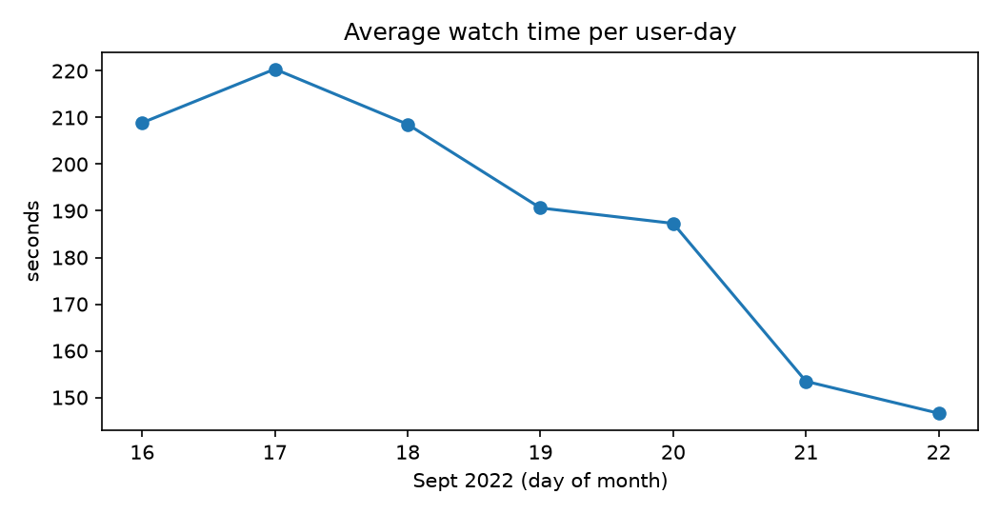
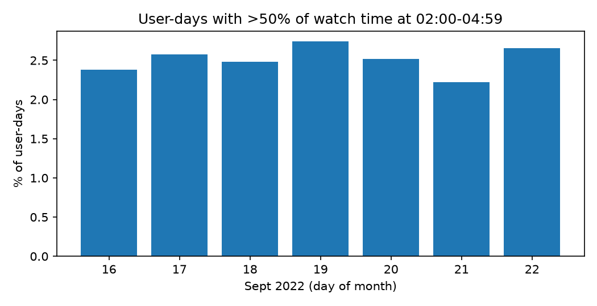
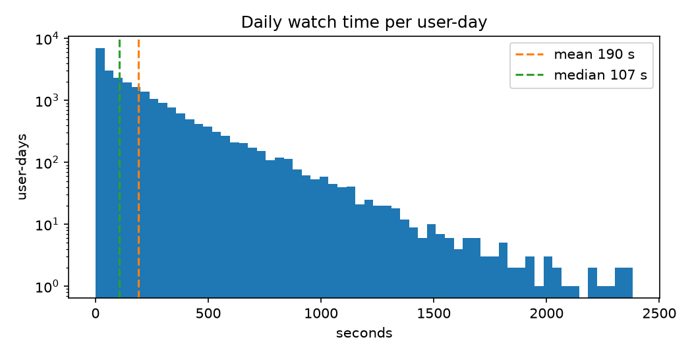
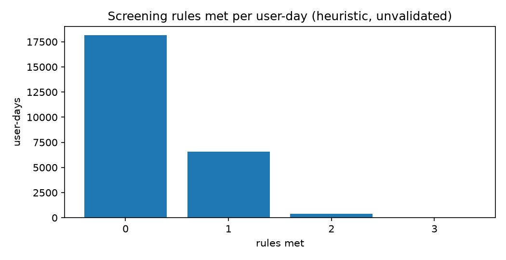

# Short-Video Usage Pattern Analysis

Behavioral signals computed from the curated `daily_user_features` layer. These are descriptive screens, not validated measures of addiction or sleep loss.

## 0. Data coverage
- Curated partitions analysed: **7** (20220916 to 20220922)
- Raw partitions ingested: **7**
- Minimum events per user-day filter: **1** (no filter)

## 1. Exploratory statistics
- User-day records analysed: **25,109** (6,654 distinct users)
- Daily watch time: mean **189.9 s**, median **107.0 s**, 90th percentile **487.0 s**
- Longest single session: **1323.0 s**
- User-days with no watch time (late-night share undefined): **873**
- User-days with >50% of watch time in the late-night window (02:00-04:59): **630** (2.5%), from **506** distinct users

### Records per day
| p_date | user-days | users | avg watch (s) | late-night heavy user-days |
| --- | --- | --- | --- | --- |
| 20220916 | 3,865 | 3,865 | 208.9 | 92 |
| 20220917 | 3,879 | 3,879 | 220.4 | 100 |
| 20220918 | 3,870 | 3,870 | 208.5 | 96 |
| 20220919 | 3,505 | 3,505 | 190.6 | 96 |
| 20220920 | 3,532 | 3,532 | 187.3 | 89 |
| 20220921 | 3,329 | 3,329 | 153.4 | 74 |
| 20220922 | 3,129 | 3,129 | 146.6 | 83 |

## 2. Late-night usage
A subset of user-days spends most watch time inside the late-night window (02:00-04:59). This marks a late-night viewing pattern; the data has no sleep or well-being measure, so it cannot show sleep deprivation.

## 3. Rule-based screening flag (heuristic, not a risk score)
Three rules, each worth one point per user-day:
- Watch time above the 75th percentile (262.0 s)
- Hate rate above 1%
- Late-night share above 10%

| Flag level | user-days | share of user-days |
| --- | --- | --- |
| At least 1 rule | 6,970 | 27.8% |
| At least 2 rules | 378 | 1.5% |
| All 3 rules | 0 | 0.0% |

Individual rules: high watch time 6,254, hate rate 64, late-night 1,030.

The strictest level (all 3 rules) is the most defensible for review. A single rule is common and not meaningful alone. No outcome data exists to validate any level, so `risk_scores` remains unpopulated.

## 4. Visualizations
Generated by `scripts/risk_analytics.py` from the same user-days as the tables above.

These are descriptive plots of one 7-day sample. They show what happened in this sample, not a trend or a validated risk level.
